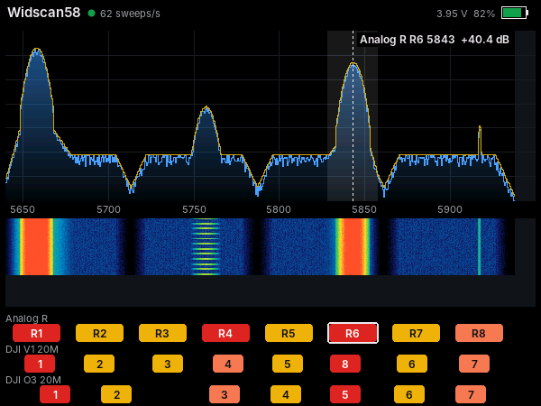
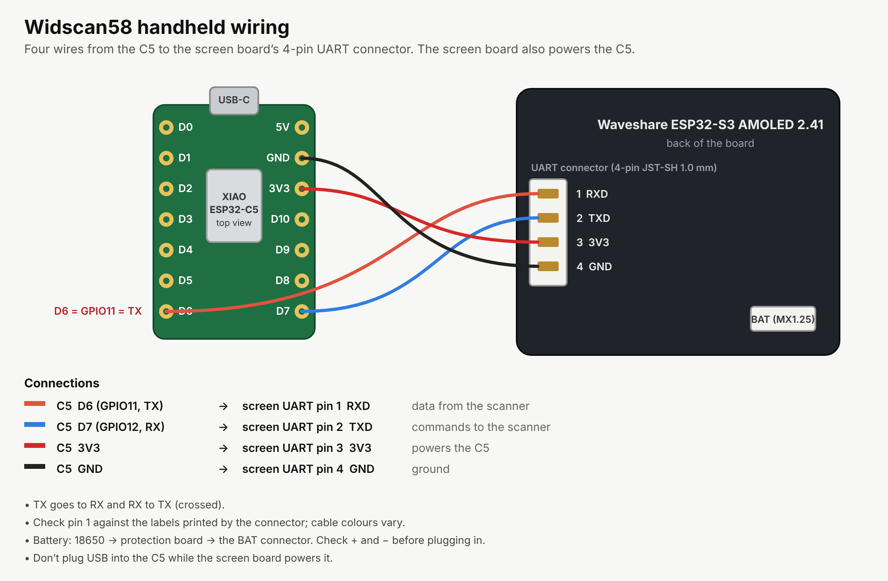

# Widscan58 handheld

Firmware for a pocket version of [Widscan58](https://github.com/CapnBry/widscan58):
the ESP32-C5 keeps scanning, and a **Waveshare ESP32-S3-Touch-AMOLED-2.41**
(600×450 AMOLED, touch, LiPo charger) shows the band. The two boards talk over
the C5's serial port, the same protocol the web UI uses over USB.



*Rendered on a PC from a simulated scan (VTXs on R1 and R6, Wi-Fi bursts near
5757 MHz, a spur near 5917 MHz), with R6 selected.*

## The screen

- **Status bar:** sweeps per second, and the battery: voltage and percentage
  on battery; while charging, the gauge fills over and over beside a lightning
  bolt (the voltage the board reads while charging is the charger's, so it
  can't give a percentage).
- **Charging screen:** plugging USB into a switched-off handheld starts it on a
  full-screen charging display with the scanner idle (its LED dark). Press the
  power key to scan; unplugging USB turns it off again.
- **Spectrum:** the whole band, 5640–5950 MHz, across the full width (no scale
  labels: the channel rows below share its frequency axis), stitched from the scanner's LO
  segments (each point from the nearest LO, as the web UI's panorama). Blue is
  live, amber the max hold, which fades back to the live trace over about a minute. Dark columns are parts of the band no LO reaches.
- **Waterfall:** the last ~2 seconds, to tell a steady VTX from on-and-off Wi-Fi.
- **Channel rows:** three platforms (by default Analog R, DJI V1 20 MHz and DJI O3 20 MHz; Oscar Liang's chart, as the Android app's
  Channels tab), each channel coloured by its mean power above the band's noise
  floor: green < 4 dB, yellow 4–9, orange 9–16, red ≥ 16, grey not scanned.
  Each row's platform name sits just above its boxes.

## Controls

| Do | To |
|---|---|
| Tap a row's name (just above its boxes) | Change that row to the next platform (kept across restarts) |
| Tap a channel | Mark it on the spectrum with its level; tap again to clear |
| Tap the spectrum | Reset the max hold and the average |
| Tap the status bar | Change the brightness (4 steps, kept) |
| Power key, hold to turn on | Keep holding until the screen lights |
| Power key, short press | Screen off / on (the scan keeps running) |
| Power key, hold 2 s | Power off (on USB: the charging screen, scanner idle) |

The screen dims after 3 minutes without a touch (the first tap only wakes it),
and the board powers off when the cell stays below 3.0 V for 20 seconds.

## Wiring

| ESP32-C5 (XIAO) | Waveshare UART connector (JST-SH 1.0, 4 pins) |
|---|---|
| GPIO11 / D6 (TX) | pin 1, RXD (GPIO44) |
| GPIO12 / D7 (RX) | pin 2, TXD (GPIO43) |
| BAT+ pad (on the back) | pin 3, 3V3 |
| GND | pin 4, GND |



The Waveshare board's 3.3 V regulator (MP1605, 2 A) powers the C5 too,
through the XIAO's BAT+ pad: the XIAO ESP32-C5's 3V3 pin is an output and
won't take power in. It runs fine from 3.3 V on BAT+. Put the 18650 (with a
protection board) on the board's MX1.25 battery connector; its USB-C port
charges it. Don't plug USB into the C5 while it's wired to the display board:
flash and set it up first.

The C5 boots in lap timer mode. The handheld sends `PROTOCOL MONITOR` to it at
power on (every 3 s until it answers) and whenever its data stops (five
tries, then "tap to retry"). The C5
answers on whichever port last sent it a command, so plugging the phone app in
over USB takes it over until you tap the handheld's spectrum.

## Flashing

1. Download `widscan58-handheld-N.bin` from this repository's Releases (or the
   `widscan58-handheld` artifact of a pull request's build).
2. Plug the Waveshare board into a computer over USB-C. If it doesn't show up,
   hold BOOT while pressing RESET.
3. Open [ESP Tool](https://espressif.github.io/esptool-js/) in Chrome or Edge,
   connect at 921600 baud, and flash the file at address **0x0**.
   Or from a terminal: `esptool.py --chip esp32s3 write_flash --flash_mode dio 0x0 widscan58-handheld-N.bin`
   (the board's flash needs DIO mode).

The board prints a status line every 5 seconds on its USB serial port
(frames per second, frames from the C5, CRC errors).

## Building

GitHub Actions builds it (`.github/workflows/handheld.yml`) with PlatformIO:
`pio run -d handheld`. `test/host.cpp` runs the parser, model and UI on a PC
and renders the screen:

```sh
g++ -O2 -std=c++17 -Isrc test/host.cpp src/{proto,scanner,ui,gfx,fonts}.cpp -o host && ./host screen.ppm
```

`src/fonts.cpp` is generated from the Inter typeface by `tools/make_fonts.py`
(Inter: SIL Open Font License 1.1).
